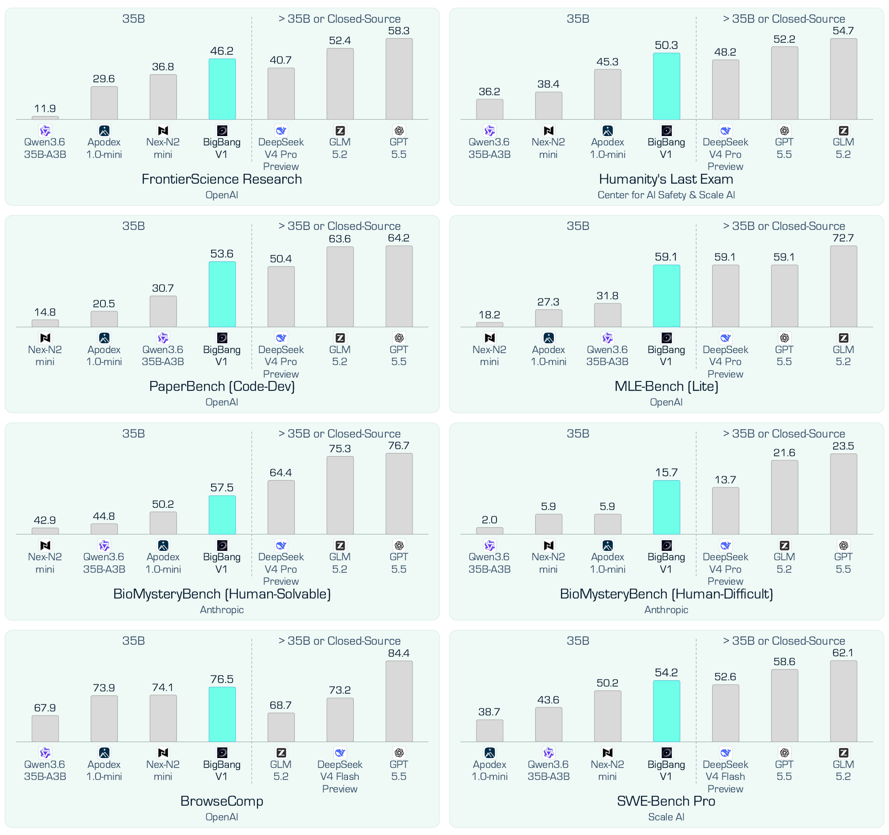

<div align="center">

# BigBang-v1

<p>
  <a href="https://huggingface.co/endless-frontier/BigBang-v1"></a>
  <a href="https://endlessfrontier.tech/"></a>
  <a href="https://github.com/endless-frontier/BigBang-v1"></a>
  
</p>

</div>

**BigBang-v1** is a 35B-A3B agentic model built on Qwen3.6-35B-A3B, with 35B
total parameters and 3B parameters activated during inference. We evaluate it
on long-horizon search, coding, scientific research, and AI research.

We release the reported results, a lightweight general-agent harness with
`search`, `visit`, and `code_exec`, and download support for the official
SWE-Bench Pro and SciCode-Verified datasets.

## Main results

BigBang-V1 on eight representative benchmarks spanning long-horizon search,
software engineering, scientific research, and AI research. BigBang-V1 obtains
the highest reported score among the selected 35B models on all eight
benchmarks. It even exceeds DeepSeek V4 Pro Preview (1.6T) on FrontierScience
Research, Humanity's Last Exam, and BioMysteryBench-HD.

<p align="center">
  <a href="./assets/bigbang_main_figure.pdf"></a>
</p>

<p align="center"><em>BigBang-v1 results on eight representative benchmarks.</em></p>

## Benchmark results

Comparison of BigBang-V1 with representative closed- and open-source frontier
models, together with models at the 35B scale, across benchmarks for
long-horizon search, coding, scientific research, and AI research. The "`-`"
indicates the score is not publicly available or not tested.

<table>
<thead>
<tr>
  <th rowspan="2" align="left">Benchmark</th>
  <th colspan="3" align="center">Closed-Source Models</th>
  <th colspan="4" align="center">Open-Source Models</th>
  <th colspan="5" align="center">35B Models</th>
</tr>
<tr>
  <th align="center">Claude<br>Opus 4.8</th>
  <th align="center">Gemini<br>3.1 Pro</th>
  <th align="center">GPT<br>5.5</th>
  <th align="center">GLM<br>5.2</th>
  <th align="center">DeepSeek V4<br>Flash Preview</th>
  <th align="center">DeepSeek V4<br>Pro Preview</th>
  <th align="center">Step-3.7<br>Flash</th>
  <th align="center">Qwen3.6<br>35B-A3B</th>
  <th align="center">Nex-N2<br>mini</th>
  <th align="center">Agents<br>A1</th>
  <th align="center">Apodex<br>1.0-mini</th>
  <th align="center">BigBang<br>V1</th>
</tr>
</thead>
<tbody>
<tr><td colspan="13" align="center"><em>Long-horizon Search</em></td></tr>
<tr><td>BrowseComp</td><td align="center">84.3</td><td align="center">85.9</td><td align="center">84.4</td><td align="center">68.7</td><td align="center">73.2</td><td align="center">83.4</td><td align="center">75.8</td><td align="center">67.9</td><td align="center">74.1</td><td align="center">48.5</td><td align="center">73.9</td><td align="center"><strong>76.5</strong></td></tr>
<tr><td>xbench</td><td align="center">61.4</td><td align="center">65.0</td><td align="center">72.4</td><td align="center">65.8</td><td align="center">62.2</td><td align="center">64.8</td><td align="center">50.8</td><td align="center">32.6</td><td align="center">57.2</td><td align="center">52.4</td><td align="center">61.8</td><td align="center"><strong>58.4</strong></td></tr>
<tr><td colspan="13" align="center"><em>Coding Tasks</em></td></tr>
<tr><td>SWE-Bench Pro</td><td align="center">69.2</td><td align="center">54.2</td><td align="center">58.6</td><td align="center">62.1</td><td align="center">52.6</td><td align="center">55.4</td><td align="center">56.3</td><td align="center">43.6</td><td align="center">50.2</td><td align="center">42.3</td><td align="center">38.7</td><td align="center"><strong>54.2</strong></td></tr>
<tr><td>SciCode-V-Sub</td><td align="center">92.3</td><td align="center">-</td><td align="center">95.1</td><td align="center">84.3</td><td align="center">83.7</td><td align="center">90.2</td><td align="center">-</td><td align="center">56.5</td><td align="center">39.0</td><td align="center">64.1</td><td align="center">-</td><td align="center"><strong>68.6</strong></td></tr>
<tr><td>SciCode-V-Main</td><td align="center">78.1</td><td align="center">-</td><td align="center">90.6</td><td align="center">70.3</td><td align="center">68.6</td><td align="center">78.1</td><td align="center">-</td><td align="center">26.6</td><td align="center">15.6</td><td align="center">50.0</td><td align="center">-</td><td align="center"><strong>50.0</strong></td></tr>
<tr><td colspan="13" align="center"><em>Scientific Research</em></td></tr>
<tr><td>FS-R</td><td align="center">45.2</td><td align="center">24.8</td><td align="center">58.3</td><td align="center">52.4</td><td align="center">37.7</td><td align="center">40.7</td><td align="center">37.2</td><td align="center">11.9</td><td align="center">36.8</td><td align="center">38.4</td><td align="center">29.6</td><td align="center"><strong>46.2</strong></td></tr>
<tr><td>HLE</td><td align="center">57.9</td><td align="center">51.4</td><td align="center">52.2</td><td align="center">54.7</td><td align="center">45.1</td><td align="center">48.2</td><td align="center">47.2</td><td align="center">36.2</td><td align="center">38.4</td><td align="center">46.3</td><td align="center">45.3</td><td align="center"><strong>50.3</strong></td></tr>
<tr><td>BioMystery-HS</td><td align="center">88.5</td><td align="center">-</td><td align="center">76.7</td><td align="center">75.3</td><td align="center">68.0</td><td align="center">64.4</td><td align="center">57.5</td><td align="center">44.8</td><td align="center">42.9</td><td align="center">48.9</td><td align="center">50.2</td><td align="center"><strong>57.5</strong></td></tr>
<tr><td>BioMystery-HD</td><td align="center">42.4</td><td align="center">-</td><td align="center">23.5</td><td align="center">21.6</td><td align="center">23.5</td><td align="center">13.7</td><td align="center">11.8</td><td align="center">2.0</td><td align="center">5.9</td><td align="center">2.0</td><td align="center">5.9</td><td align="center"><strong>15.7</strong></td></tr>
<tr><td colspan="13" align="center"><em>AI Research</em></td></tr>
<tr><td>MLE-Bench</td><td align="center">63.6</td><td align="center">-</td><td align="center">59.1</td><td align="center">72.7</td><td align="center">40.9</td><td align="center">59.1</td><td align="center">40.9</td><td align="center">31.8</td><td align="center">18.2</td><td align="center">27.3</td><td align="center">27.3</td><td align="center"><strong>59.1</strong></td></tr>
<tr><td>PaperBench</td><td align="center">-</td><td align="center">-</td><td align="center">64.2</td><td align="center">63.6</td><td align="center">40.4</td><td align="center">50.4</td><td align="center">36.7</td><td align="center">30.7</td><td align="center">14.8</td><td align="center">17.3</td><td align="center">20.5</td><td align="center"><strong>53.6</strong></td></tr>
</tbody>
</table>

We use a strict evaluation-time decontamination policy to prevent direct
retrieval of benchmark artifacts or reference answers. We reject queries that
explicitly target Hugging Face, filter search results from `huggingface.co`,
`hf.co`, and their subdomains, block direct `visit` calls to those domains, and
never expose reference answers in agent-visible messages or tool outputs.
Comparison scores may therefore differ from official reports that use other
harnesses or web-access policies.

The table matches the complete result table on the BigBang-v1 Hugging Face
model card. BrowseComp, xbench, FrontierScience-Research, and HLE use the
general-agent runner in this repository. SWE-Bench Pro and SciCode-Verified use
their benchmark-specific official harnesses, as described below.

## Supported evaluations

| Script identifier | Evaluation | Official data source | Evaluation protocol |
|---|---|---|---|
| `browsecomp` | BrowseComp | [OpenAI encrypted CSV](https://openaipublic.blob.core.windows.net/simple-evals/browse_comp_test_set.csv) | 5× discard-all; force a final answer at the fifth-attempt limit |
| `xbench` | xbench-DeepSearch-2510 | [xbench encrypted CSV](https://github.com/xbench-ai/xbench-evals/blob/main/data/DeepSearch-2510.csv) | Avg@5, aligned with the official default |
| `frontierscience` | FrontierScience-Research | [`openai/frontierscience`](https://huggingface.co/datasets/openai/frontierscience) research split | Avg@30, aligned with the official default |
| `hle` | Humanity's Last Exam, text-only | Gated [`cais/hle`](https://huggingface.co/datasets/cais/hle) dataset | One score per text-only item |
| `swebench-pro` | SWE-Bench Pro | [`ScaleAI/SWE-bench_Pro`](https://huggingface.co/datasets/ScaleAI/SWE-bench_Pro) test split | Evaluated with the benchmark's official [mini-SWE-agent harness and evaluator](https://github.com/scaleapi/SWE-bench_Pro-os) |
| `scicode-verified` | SciCode-Verified | [SciCode-Verified v2 release](https://github.com/flyingwagner/scicode-verified/releases/tag/data) | Evaluated with the official [SciCode-Verified harness](https://github.com/flyingwagner/scicode-verified); pass@1 with cumulative subproblems and all-or-nothing main-problem scoring |

For BrowseComp, we use five discard-all attempts and force a final answer when
the fifth-attempt limit is reached. We evaluate xbench with Avg@5 and
FrontierScience-Research with Avg@30, matching their official defaults.

SWE-Bench Pro and SciCode-Verified are not run through the general
`search`/`visit`/`code_exec` loop. SWE-Bench Pro uses the official public test
split, official mini-SWE-agent harness, and official evaluator. SciCode-Verified
uses its official with-background pass@1 protocol: subproblems are cumulative,
and a main problem passes only when all of its scored subproblems pass.

BrowseComp and xbench are MIT licensed through their official repositories.
FrontierScience is Apache-2.0. HLE is marked MIT but gated, and its dataset card
asks users not to publicly share, re-upload, or distribute the dataset. The
SWE-Bench Pro reference repository and mini-SWE-agent fork are MIT licensed;
SciCode-Verified is distributed under Apache-2.0. We provide download scripts
rather than copies of benchmark data. See [`THIRD_PARTY.md`](THIRD_PARTY.md)
for source and license links.

## General-agent tool policy

For BrowseComp, xbench, FrontierScience-Research, and HLE, we run each item in
an OpenAI-compatible tool-calling loop with:

- `search`: Google Search results through Serper;
- `visit`: webpage reading through Jina Reader followed by goal-conditioned
  extraction using an explicitly configured summary-model endpoint;
- `code_exec`: a persistent, per-item E2B shell sandbox.

Each trajectory is capped at 500 tool calls. During evaluation, we remove
Hugging Face pages from `search` results and block direct `visit` calls to those
pages. The separate data-download script is not subject to this restriction.

## Installation

Python 3.10 or later is required.

```bash
python -m venv .venv
source .venv/bin/activate
pip install -e .
cp .env.example .env
```

The package does not install a console command. Run the scripts in `scripts/`
directly.

Set `OPENAI_BASE_URL`, `OPENAI_API_KEY`, and `OPENAI_MODEL` for the evaluated
model's OpenAI-compatible endpoint. `SERPER_API_KEY`, `JINA_API_KEY`, and
`E2B_API_KEY` enable the three tools. `VISIT_SUMMARY_BASE_URL`,
`VISIT_SUMMARY_API_KEY`, and `VISIT_SUMMARY_MODEL` configure the extraction
stage in `visit`. Judge settings are separate and are needed only with
`--judge`.

Serve BigBang-v1 with SGLang as follows:

```bash
python -m sglang.launch_server \
  --model-path endless-frontier/BigBang-v1 \
  --host 0.0.0.0 \
  --port 8000 \
  --context-length 262144 \
  --tool-call-parser qwen3_coder \
  --reasoning-parser qwen3
```

## Download benchmark data

Download the three non-gated benchmarks:

```bash
python scripts/download_data.py \
  --benchmarks browsecomp xbench frontierscience
```

For HLE, accept the access conditions on Hugging Face, set `HF_TOKEN`, and run:

```bash
python scripts/download_data.py --benchmarks hle
```

Download the official SWE-Bench Pro test split:

```bash
python scripts/download_data.py --benchmarks swebench-pro
```

Download the SciCode-Verified v2 manifest, JSONL, and grading HDF5. The HDF5 is
approximately 1.1 GB; all three files are checked against the release manifest
and pinned MD5 values.

```bash
python scripts/download_data.py --benchmarks scicode-verified
```

## Run the general-agent evaluations

Run one BrowseComp item once:

```bash
python scripts/run_eval.py \
  --benchmark browsecomp \
  --limit 1 \
  --repeats 1 \
  --output outputs/browsecomp-smoke.jsonl
```

Omit `--limit` for a full run. Without `--repeats`, the runner uses Avg@5 for
xbench and Avg@30 for FrontierScience-Research.

```bash
python scripts/run_eval.py \
  --benchmark xbench \
  --output outputs/xbench.jsonl
```

Add `--judge` to score answers with an OpenAI-compatible judge. Configure the
judge endpoint separately from the evaluated-model endpoint.

```bash
python scripts/run_eval.py \
  --benchmark frontierscience \
  --output outputs/frontierscience.jsonl \
  --judge
```

The runner writes one JSON record per item and repeat. Each record contains the
benchmark, item identifier, repeat index, final response, tool-call count, and
conversation trajectory. With `--judge`, it also contains the parsed score and
raw judge response. The runner rejects an existing output path unless
`--overwrite` is supplied.

Keep credentials in an untracked `.env` file or secret manager. Do not commit
downloaded benchmark data, generated trajectories, reference answers, or
service keys.

## License

The harness is released under the Apache License 2.0. Benchmark datasets and
attributed upstream components remain subject to their respective terms; see
[`THIRD_PARTY.md`](THIRD_PARTY.md).
